# img2softmesh

Turn a photo of a household textile (t-shirt, towel, sock, blanket…) into a textured, simulation-ready
soft cloth mesh for robotics, with a MuJoCo scene to try it in.

## How it works

```
photo ──► segment ──► cloth mesh ──► MuJoCo scene ──► grasp demo
          (rembg)      │
                       ├─ silhouette  outline mesh, photo as texture        (CPU, seconds)
                       └─ trellis     + 3D shape and back side, TRELLIS.2    (local GPU, ~2 min)
```

## Examples

| Photo | Simulation |
|:---:|:---:|
| 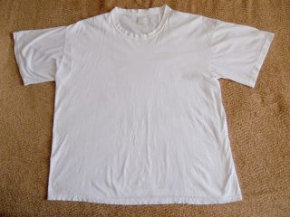 | 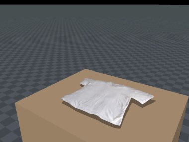<br>t-shirt, `trellis` |
|  | 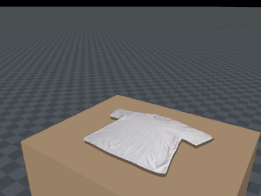<br>t-shirt, `silhouette` |
| 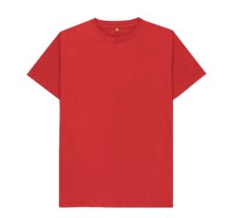 | 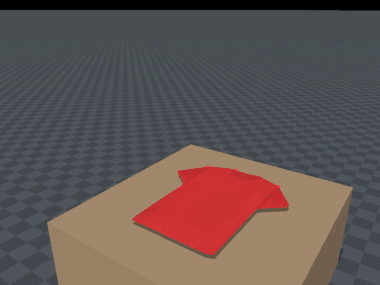<br>t-shirt |
| 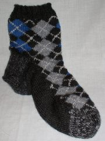 | 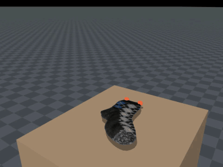<br>sock |
| 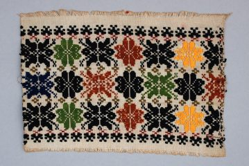 | 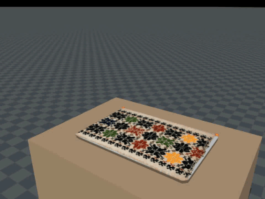<br>towel |
| 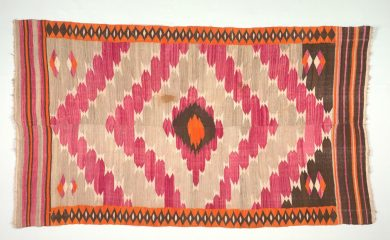 | 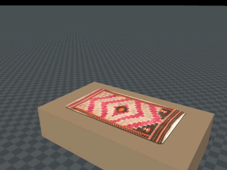<br>blanket |

## Quick start

```bash
uv sync --extra rembg --extra trellis
uv run img2softmesh demo examples/tshirt.jpg --kind tshirt
```

This opens the MuJoCo viewer: grippers take the cloth by its corners (sleeves and collar for shirts),
lift it until it hangs free, shake it, and lay it back down flat.

## Commands

```bash
img2softmesh make photo.jpg --kind tshirt           # build out/photo/ (mesh, texture, scene.xml)
img2softmesh make photo.jpg --kind tshirt -g trellis
img2softmesh sim out/photo                          # interactive viewer
img2softmesh sim out/photo --video demo.mp4         # render to video
```

Kinds: `towel` `blanket` `sheet` `napkin` `flat` `tshirt` `sock` `pillowcase` (or `auto`).

## Tips

- Lay the item flat and shoot from above.
- Shirts look best with `--selfcollide` (keeps front and back apart; about 3x slower).
- `scene.xml` drops into any MuJoCo setup; cloth vertices are bodies named `cloth_<i>`.
- Fabric settings live in [`img2softmesh/presets.py`](img2softmesh/presets.py).
