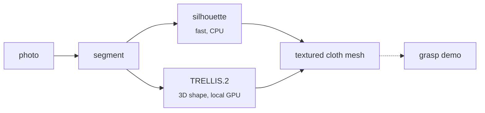

<div align="center">


Turn a photo of cloth into a textured, simulation-ready soft mesh.


</div>



| Photo | Demo |
|:---:|:---:|
|  |  |
|  |  |
|  |  |
|  |  |

## Quick start

```bash
uv sync --extra rembg --extra trellis
uv run img2softmesh demo examples/tshirt.jpg --kind tshirt
```

```bash
img2softmesh make photo.jpg --kind towel     # mesh + texture in out/photo/
img2softmesh make photo.jpg -g trellis       # use TRELLIS.2 for 3D shape
img2softmesh sim out/photo                   # run the demo
```

Kinds: `towel` `blanket` `sheet` `napkin` `flat` `tshirt` `sock` `pillowcase` (or `auto`).
Lay the item flat and shoot from above.
